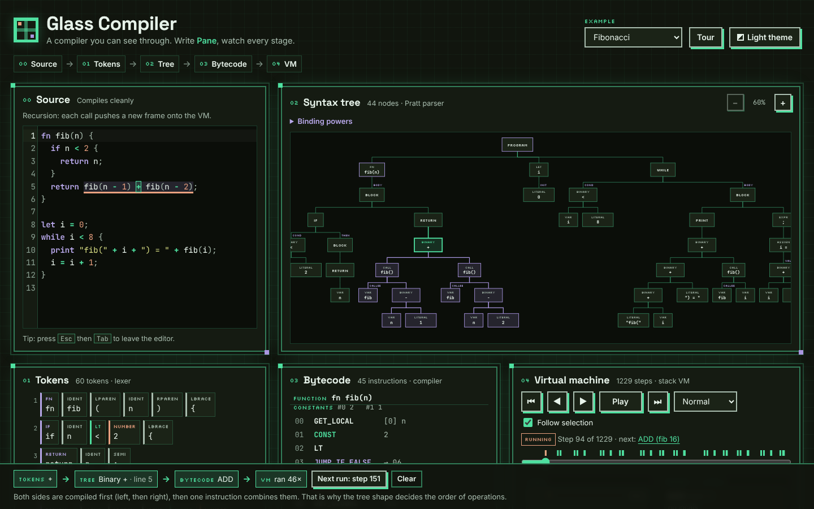
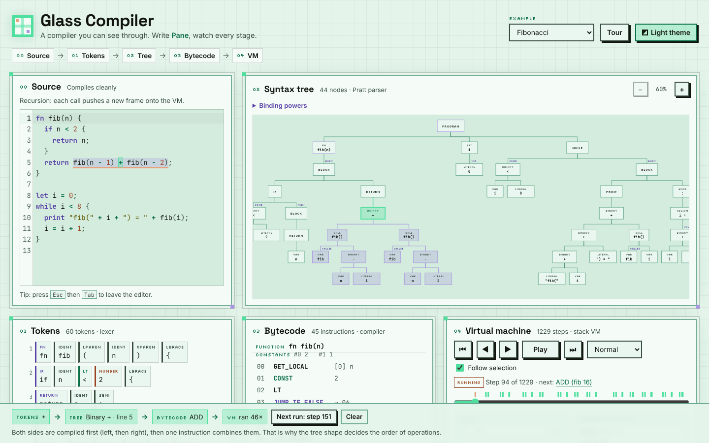
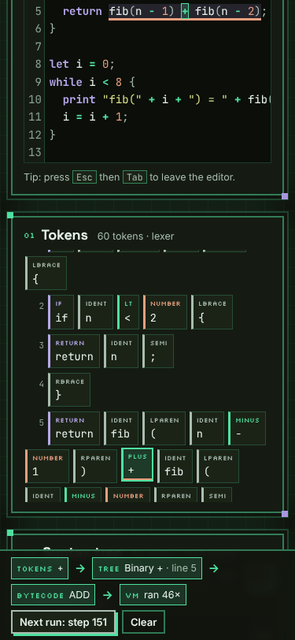

# Glass

**Computers you can see through.** The Glass series is a set of small machines
built from scratch with the glass left off. Each one is a compiler, a virtual
machine, a console or a kernel you can watch working. Click any part and see
where it came from and where it goes next. Real test suites grade every one.

**The series:** https://vincentwesley.github.io/glass-compiler/series/

## Glass Compiler (live)

**Try it:** https://vincentwesley.github.io/glass-compiler/

Write a few lines in **Pane**, a tiny language made for looking at, and watch
every stage of a real compiler work on it: the tokens, the syntax tree, the
bytecode, and a virtual machine stepping through it with its stack and variables
on show. Every stage is linked. Click a `+` in your code and its token, its tree
node, the `ADD` instruction and every VM step that ran it all light up together.



| Desktop, light theme | Phone, dark theme |
| --- | --- |
|  |  |

More in [packages/compiler/README.md](packages/compiler/README.md): the Pane
language, keyboard use, and how it is built.

## The series

| # | Project | What it is | Graded by | Status |
| --- | --- | --- | --- | --- |
| 1 | [Glass Compiler](packages/compiler) | Pane through tokens, syntax tree, bytecode and a stack VM, every stage linked | Unit tests, browser checks with axe | **Live** |
| 2 | Glass Wasm | A WebAssembly VM from scratch in Rust, with a debugger for the value stack, locals, linear memory and frames | The official WebAssembly spec testsuite | Planned (M2) |
| 3 | Small C | A C-subset compiler to WebAssembly in the spirit of chibicc, running in Glass Wasm | c-testsuite | Planned (M4) |
| 4 | Glass Console | CHIP-8, then a Game Boy, with registers, tiles, sprites and the sound channels on show | CHIP-8, Blargg and Mooneye test ROMs | Planned (M5) |
| 5 | Glass Kernel | A tiny teaching OS on a simulated RISC-V machine | Known-answer system-call tests | Planned (M6) |
| 6 | Glass Language Tools | A language server for Pane in VS Code and a web playground | LSP request and response tests | Planned (M7) |

They connect. A Pane program compiles to WebAssembly, runs in the Glass Wasm
debugger and later boots on Glass Kernel. The order, and why, is in
[docs/PLAN.md](docs/PLAN.md).

## How this repository is laid out

```
packages/glass-ui   the shared debugger kit: step controls, timeline, panels, highlighting, theme, credits
packages/compiler   Glass Compiler
packages/hub        the series site (/glass-compiler/series/)
site.config.mjs     every page's path and status
scripts/            site assembly, site checks, recorded test results
docs/               research, plan, decisions, acceptance checks, handover
```

## Privacy and security

Every Glass page is static. There is no server, no accounts, no analytics and
no requests to other sites. Your code runs in your own browser, inside virtual
machines written in TypeScript or Rust, never through `eval`. A strict Content
Security Policy blocks inline scripts and third-party hosts. See
[SECURITY.md](SECURITY.md) to report a problem.

## Running it yourself

You need Node 24 (see `.nvmrc`).

```sh
npm ci --ignore-scripts
npm run dev          # Glass Compiler at http://localhost:5173/glass-compiler/
npm run verify       # typecheck, lint, unit tests and build for every package
npm run test:e2e     # Playwright + axe for every package
```

`npm run build` writes the whole site to `_site/`; `node scripts/check-site.mjs`
checks it, and `node scripts/serve-site.mjs` serves it locally.

## Licence

MIT, copyright (c) 2026 Vin's Atelier (Vincent Wesley). See [LICENSE](LICENSE).

This project is **provided as is, no warranty**: use it at your own risk.

Third-party components and their licences are listed in
[THIRD_PARTY_NOTICES.md](THIRD_PARTY_NOTICES.md). The fonts (Space Grotesk,
Inter, Silkscreen and JetBrains Mono) are bundled from
[Fontsource](https://fontsource.org/) under the SIL Open Font License 1.1.

## Credits

Designed and built by Vin, Vin's Atelier (https://vwesley.dev). Logo by
@portus_workstation / @wason25_pz (Instagram). The logo and the credits-card
art are all rights reserved (see [NOTICE.md](NOTICE.md)) and are not covered by
the MIT licence.

---

Made by Vin, Vin's Atelier.
