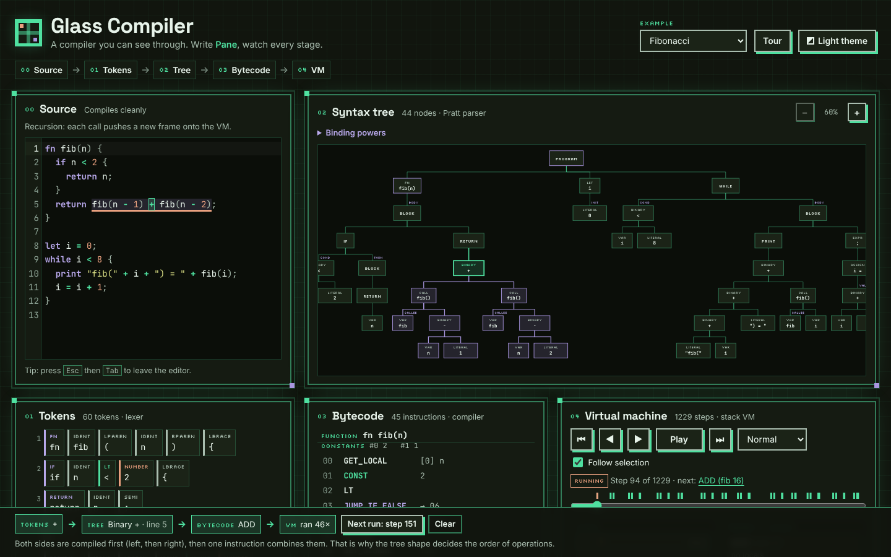
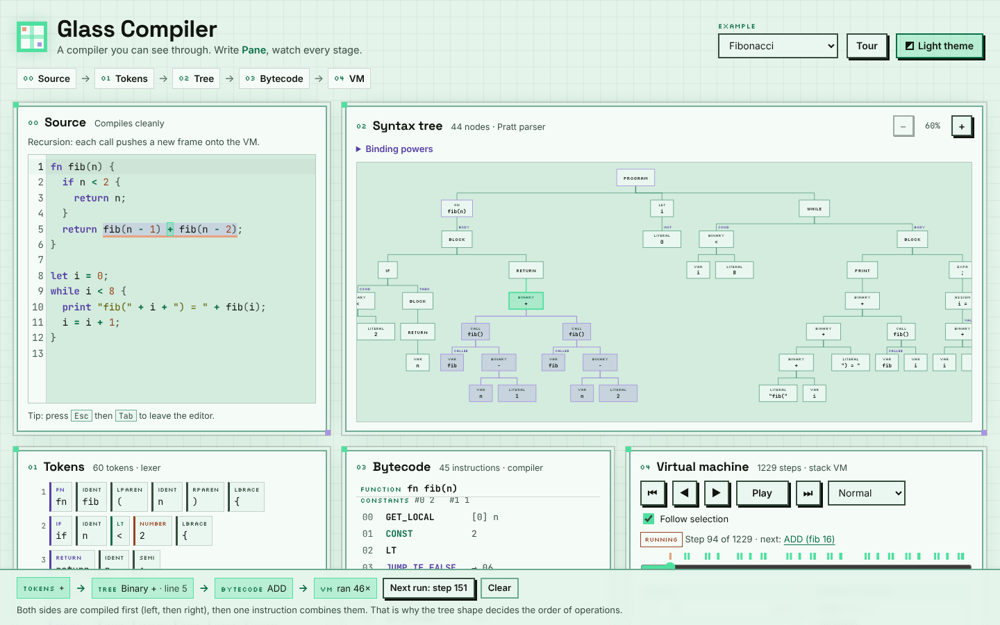
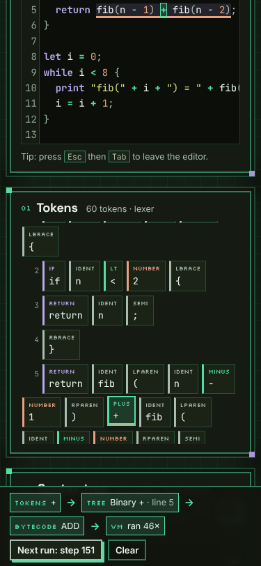

# Glass Compiler

**A compiler you can see through.** Write a few lines in **Pane**, a tiny
language made for looking at, and watch every stage of a real compiler work on
it: the tokens, the syntax tree, the bytecode, and a virtual machine stepping
through it with its stack and variables on show.

Every stage is linked. Click a `+` in your code and its token, its tree node,
the `ADD` instruction it compiled to and every VM step that ran it all light up
together.

**Try it:** https://vincentwesley.github.io/glass-compiler/



## What you can do

- **Edit and watch.** Every stage updates as you type. Mistakes are underlined
  and explained, with the line and column.
- **Click anything.** A token, a tree node, a bytecode instruction or a line of
  output. The lineage bar at the bottom says, in words, what that piece became
  at each stage and what it means.
- **Step the machine.** Step forwards and backwards, play, scrub the timeline,
  and see the stack, call frames, locals, globals and output at every step. The
  marks above the timeline show when the selected code ran.
- **See why precedence works.** Open *Binding powers* in the tree panel for the
  numbers the Pratt parser uses to decide that `1 + 2 * 3` multiplies first.
- **Follow the jumps.** Rows that a jump lands on are marked with where the
  jump comes from (`◂ 13`), and selecting a jump highlights its landing row.
- **Share a program.** *Copy share link* puts your code in the link itself
  (after the `#`), so it never passes through a server.
- **Learn from examples.** Precedence, variables and scope, a countdown loop,
  FizzBuzz and recursive Fibonacci are built in, and a short guided tour runs on
  your first visit (restart it with **Tour**).

Colour key: **mint** is what you selected, **lavender** is inside it, and
**peach** is what the machine will run next.

| Desktop, light theme | Phone, dark theme |
| --- | --- |
|  |  |

## The Pane language

```pane
# Comments start with a hash.
let greeting = "hello";          # top-level let: a global
print greeting + ", pane";       # + joins strings (and anything onto a string)

fn fib(n) {                      # functions live at the top level
  if n < 2 { return n; }
  return fib(n - 1) + fib(n - 2);
}

let i = 0;
while i < 8 {
  let shown = fib(i);            # let inside a block: a local in a stack slot
  print "fib(" + i + ") = " + shown;
  i = i + 1;
}
```

- **Values:** numbers, strings (`"..."`, with `\n`, `\t`, `\"`, `\\`),
  `true`, `false`, `nil`, and functions.
- **Statements** end with `;`: `let`, assignment, `print`, `if` / `else if` /
  `else`, `while`, `fn`, `return`, and `{ blocks }`.
- **Operators**, loosest to tightest: `=`, `or`, `and`, `not`, `== !=`,
  `< <= > >=`, `+ -`, `* / %`, unary `-`, calls.
- Only `false` and `nil` count as false. Dividing by zero, mixing types in
  arithmetic, using an undeclared variable or calling with the wrong number of
  arguments stops the program with a message that points at the code.
- Programs stop after 10,000 steps or 64 nested calls, so a runaway loop can't
  freeze the page.

## Keyboard

- **Tab** moves between panels; inside the Tokens, Tree and Bytecode panels the
  **arrow keys**, **Home** and **End** move between items and **Enter**
  selects.
- In the editor, **Tab** indents. Press **Esc** then **Tab** to leave it.
- The VM scrubber works with the arrow keys.

## Privacy and security

Glass Compiler is a static page. It has no server, no accounts, no analytics and
makes no network requests after loading. Share links carry the program in the
part of the URL after `#`, which browsers don't send to servers. Your code runs in a small virtual
machine written in TypeScript (never `eval`) and your latest draft is kept only
in your own browser's local storage. A strict Content Security Policy blocks
inline scripts and third-party hosts. See [SECURITY.md](SECURITY.md) to report
a problem.

## Running it yourself

You need Node 24 (see `.nvmrc`).

```sh
npm ci --ignore-scripts
npm run dev          # http://localhost:5173/glass-compiler/
npm run verify       # typecheck, lint, unit tests, production build
npm run test:e2e     # Playwright + axe accessibility checks
```

How it works, and why it was built this way, is written up in
[docs/PLAN.md](docs/PLAN.md), [docs/DECISIONS.md](docs/DECISIONS.md) and
[docs/RESEARCH.md](docs/RESEARCH.md).

## Licence

MIT, copyright (c) 2026 Vincent Wesley. See [LICENSE](LICENSE).

This project is **provided as is, no warranty**: use it at your own risk.

The fonts (Space Grotesk, Inter, Silkscreen and JetBrains Mono) are bundled from
[Fontsource](https://fontsource.org/) under the SIL Open Font License 1.1; their
licence texts are in [public/licenses/FONTS-OFL.txt](public/licenses/FONTS-OFL.txt).

---

Made by Vincent Wesley.
