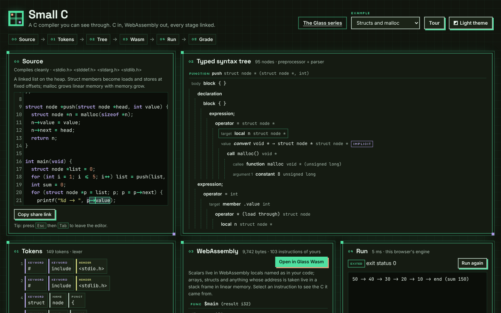

# Small C

**A C compiler you can see through.** Small C compiles most of C to a real
WebAssembly module, in the spirit of [chibicc](https://github.com/rui314/chibicc):
a preprocessor, a parser that works out the type of every expression, and a
code generator, all written from scratch in TypeScript. The page shows every
stage, linked: click a token, a tree node or a WebAssembly instruction and the
others light up.

**Try it:** https://vincentwesley.github.io/glass-compiler/small-c/



## Graded by c-testsuite

[c-testsuite](https://github.com/c-testsuite/c-testsuite)'s `single-exec` suite
is a pinned submodule at `packages/small-c/testsuite`: 220 C programs from the
tcc and scc compilers, each with the exact output it must print.

**220 of 220 pass**, run on Node's WebAssembly engine **and** on
[Glass Wasm](../wasm/), the series' own VM, which agree on every test. Nothing is
skipped. A test passes when its stdout and stderr match the `.expected` file
byte for byte and it exits with status 0.

## What it compiles

- Types: `char` to `long long`, signed and unsigned, `_Bool`, `float`, `double`,
  pointers, arrays (including variable-length), structs, unions, enums,
  bit-fields, flexible array members, function pointers, `typedef`, `const`.
- Initialisers: nested, designated (`.x =`, `[3] =`, GNU ranges), brace
  elision, compound literals, string literals for char arrays.
- Statements: everything, including `goto`, `switch` with cases anywhere
  (Duff's device), and GNU statement expressions.
- The preprocessor: `#include` of the built-in headers, object- and
  function-like macros with `#`, `##` and `__VA_ARGS__`, `#if` with `defined`,
  `#line`, `#pragma push_macro`.
- The target is wasm32 with ILP32 sizes (as clang's wasm32); `long double` is a
  `double`. Not supported: threads and atomics, `_Complex`, `setjmp`,
  wide-character library functions, computed goto.

## How the WebAssembly looks

- A scalar whose address is never taken is a WebAssembly local with its C name.
  Arrays, structs and address-taken variables live in a stack frame in linear
  memory.
- Loops, `if` and `switch` are structured `block`/`loop`/`if`; a dense `switch`
  is one `br_table`. A function with `goto` becomes numbered blocks under one
  dispatch loop.
- The C library (printf, malloc, strings, maths, files in memory) is C too,
  compiled with your program; only what it uses is kept. It needs two host
  imports, `c.write` and `c.exit`. `printf("%f")` prints a double's exact value,
  rounded half to even as glibc does.

Design notes: [docs/DECISIONS.md](../../docs/DECISIONS.md) S17 to S20.

## Running it yourself

From the repository root, with Node 24 (and Rust for the Glass Wasm engine):

```sh
git submodule update --init --depth 1     # c-testsuite
npm test -w @glass/small-c                # unit tests
npm run build:wasm -w @glass/wasm         # Glass Wasm, the second engine
node scripts/record-results.mjs small-c   # c-testsuite on both engines → results.json
npm run dev -w @glass/small-c             # the page at http://localhost:5173/glass-compiler/small-c/
npm run test:e2e -w @glass/small-c        # Playwright + axe on the built site
```

## Licence and credits

MIT, copyright (c) 2026 Vin's Atelier (Vincent Wesley). Designed and built by
Vin, Vin's Atelier. The maths functions use fdlibm's polynomial coefficients
(Sun Microsystems, freely distributable); c-testsuite and its test programs keep
their own licences and are not shipped (see
[THIRD_PARTY_NOTICES.md](../../THIRD_PARTY_NOTICES.md)). The logo (by
@portus_workstation / @wason25_pz) and the credits-card art are all rights
reserved; see [NOTICE.md](../../NOTICE.md). Provided as is, no warranty.
