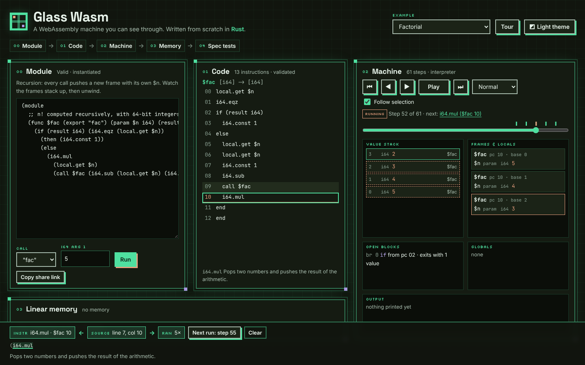

# Glass Wasm

**A WebAssembly machine you can see through.** A WebAssembly 1.0 virtual
machine written from scratch in Rust, with no dependencies. It is compiled to
WebAssembly itself, so its debugger runs in your browser: the value stack, call
frames and their locals, open blocks and linear memory are on show at every
step.

**Try it:** https://vincentwesley.github.io/glass-compiler/wasm/



## Graded by the official testsuite

Glass Wasm runs the WebAssembly working group's own testsuite: every `.wast`
file in `test/core` of [WebAssembly/spec at tag `wg-1.0`](https://github.com/WebAssembly/spec/tree/wg-1.0/test/core),
a shallow git submodule at `packages/wasm/spec`.

**19,270 of 19,270 commands pass, in all 73 files.** The page shows the
recorded count per file and can run the same files again in your browser
(about 4 seconds on the live site, fetching the 73 files included).

How it's graded:

- `assert_return`, `assert_return_canonical_nan` and
  `assert_return_arithmetic_nan` compare results bit for bit.
- `assert_trap` and `assert_exhaustion` need a trap whose message starts with
  the expected text, as in the reference interpreter.
- `assert_malformed`, `assert_invalid` and `assert_unlinkable` need the module
  to be rejected at the right stage: decoding or parsing, validation, or
  linking. They don't need the exact wording, as is usual for independent
  implementations.

## Pane programs, compiled

Glass Compiler compiles Pane to WebAssembly, and its **Open in Glass Wasm** link
opens the module here. The Module panel shows the Pane source, values on the
stack and in locals read as Pane values, and selecting an instruction shows the
Pane line it came from. The module imports a five-function `pane` host
(`crate/src/pane_host.rs`), which Glass Wasm provides.

## C programs, compiled

Small C compiles C to WebAssembly, and its **Open in Glass Wasm** link opens the
module here too. The Module panel shows the C source, selecting an instruction
shows the C line it came from, and a program's output appears line by line as
you step. A C program imports a two-function `c` host (`crate/src/c_host.rs`):
`write` for stdout and stderr, and `exit`, which ends the run with **Exited** and
its status.

## What's inside (`crate/`)

| Module | What it does |
| --- | --- |
| `text/` | The text format: lexer, S-expressions, module parser (names, abbreviations, folded instructions), all of it from scratch |
| `binary.rs` | Binary decoder, with the spec's error messages |
| `validate.rs` | The spec's validation algorithm (operand and control stacks) |
| `runtime.rs` | Store, linking, instantiation, and a steppable interpreter with explicit stack, frames and labels |
| `exec.rs`, `float.rs` | Numeric semantics: NaN propagation, signed zeros, ties-to-even, trapping conversions, correctly rounded literals |
| `spec.rs` | The `.wast` script runner and the `spectest` host module |
| `pane_host.rs`, `jsnum.rs`, `c_host.rs` | The hosts compiled Pane and C programs import |
| `debug.rs`, `disasm.rs` | The debugger's view of a run: replay to any step, frames with named locals, the per-step trace |
| `web.rs` | C-ABI exports for the page (no wasm-bindgen) |

## Running it yourself

From the repository root, with Rust (pinned in `rust-toolchain.toml`) and Node 24:

```sh
git submodule update --init --depth 1   # the testsuite
cargo test -p glass-wasm                # unit tests
npm run spec -w @glass/wasm             # the whole testsuite, file by file
npm run dev -w @glass/wasm              # the debugger at http://localhost:5173/glass-compiler/wasm/
npm run test:e2e -w @glass/wasm         # Playwright + axe on the built site
node scripts/record-results.mjs wasm    # re-record results.json after a change
```

## Licence and credits

MIT, copyright (c) 2026 Vin's Atelier (Vincent Wesley). The testsuite files are
Apache License 2.0, by the WebAssembly Community Group (see
[THIRD_PARTY_NOTICES.md](../../THIRD_PARTY_NOTICES.md)). Designed and built by
Vin, Vin's Atelier. The logo (by @portus_workstation / @wason25_pz) and the
credits-card art are all rights reserved; see [NOTICE.md](../../NOTICE.md).
Provided as is, no warranty.
